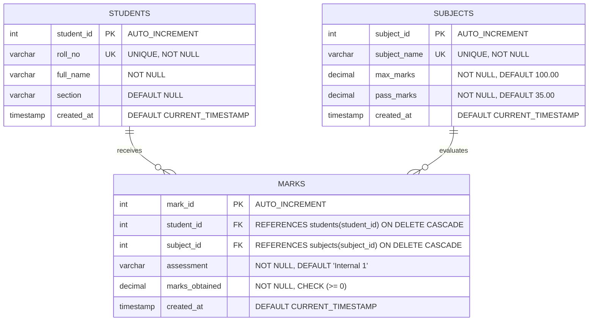

# D2. Database Design & Relational Specification

## 1. Relational Database Overview
The **Student Performance Analysis System** is backed by a normalized relational database in **MySQL** (InnoDB engine), ensuring ACID compliance, strict referential integrity, and cascading updates/deletions.

Database Name: `student_performance`  
Character Set: `utf8mb4`  
Collation: `utf8mb4_0900_ai_ci`

---

## 2. Entity-Relationship (ER) Diagram

---

## 3. Data Dictionary

### Table 1: `students`
Stores individual student demographic and cohort profile records.

| Column Name | Data Type | Constraints | Description |
|---|---|---|---|
| `student_id` | `INT` | `PRIMARY KEY`, `AUTO_INCREMENT` | Unique internal surrogate key for the student. |
| `roll_no` | `VARCHAR(30)` | `UNIQUE`, `NOT NULL` | Unique institutional academic roll number (e.g. `CSE001`). |
| `full_name` | `VARCHAR(100)` | `NOT NULL` | Student's full legal or academic name. |
| `section` | `VARCHAR(20)` | `NULLABLE` | Academic cohort/section (e.g. `A`, `B`, `C`). |
| `created_at` | `TIMESTAMP` | `DEFAULT CURRENT_TIMESTAMP` | System record creation timestamp. |

---

### Table 2: `subjects`
Maintains curriculum subject definitions and academic constraints.

| Column Name | Data Type | Constraints | Description |
|---|---|---|---|
| `subject_id` | `INT` | `PRIMARY KEY`, `AUTO_INCREMENT` | Unique internal identifier for the course. |
| `subject_name` | `VARCHAR(100)` | `UNIQUE`, `NOT NULL` | Course title (e.g. `Python Programming`). |
| `max_marks` | `DECIMAL(6,2)` | `NOT NULL`, `DEFAULT 100.00`, `CHECK (max_marks > 0)` | Maximum possible marks for the course. |
| `pass_marks` | `DECIMAL(6,2)` | `NOT NULL`, `DEFAULT 35.00`, `CHECK (pass_marks >= 0 AND pass_marks <= max_marks)` | Minimum score required to pass. |
| `created_at` | `TIMESTAMP` | `DEFAULT CURRENT_TIMESTAMP` | System record creation timestamp. |

---

### Table 3: `marks`
Stores granular assessment evaluation scores linking students to subjects.

| Column Name | Data Type | Constraints | Description |
|---|---|---|---|
| `mark_id` | `INT` | `PRIMARY KEY`, `AUTO_INCREMENT` | Unique internal surrogate key for the marks entry. |
| `student_id` | `INT` | `FOREIGN KEY`, `NOT NULL`, `ON DELETE CASCADE` | References `students(student_id)`. |
| `subject_id` | `INT` | `FOREIGN KEY`, `NOT NULL`, `ON DELETE CASCADE` | References `subjects(subject_id)`. |
| `assessment` | `VARCHAR(50)` | `NOT NULL`, `DEFAULT 'Internal 1'` | Assessment examination label. |
| `marks_obtained` | `DECIMAL(6,2)` | `NOT NULL`, `CHECK (marks_obtained >= 0)` | Numeric marks awarded to the student. |
| `created_at` | `TIMESTAMP` | `DEFAULT CURRENT_TIMESTAMP` | System record creation timestamp. |

#### Composite Unique Constraint:
- `UNIQUE KEY unique_student_subject_assessment (student_id, subject_id, assessment)`  
  *Prevents duplicate marks entries for the exact same student, subject, and assessment iteration.*

---

## 4. Referential Integrity & Cascading Behavior
1. **Student Deletion:** When a student profile is deleted (`DELETE FROM students WHERE student_id = ?`), all corresponding records in `marks` are automatically deleted via `ON DELETE CASCADE`.
2. **Subject Deletion:** When a curriculum subject is removed, associated assessment entries cascade seamlessly without leaving orphaned records.
3. **Parameterized Queries:** All database interactions in `app.py` and `analytics.py` utilize parameterized SQL queries (`%s` placeholders), completely mitigating SQL Injection (SQLi) vulnerabilities.

---

## 5. SQL Scripts
- Full schema definition: [schema.sql](file:///c:/Users/Mohammad%20Usman/Documents/StudentPerformanceAnalysisSystem/schema.sql)
- Sample demonstration seed records: [seed_data.sql](file:///c:/Users/Mohammad%20Usman/Documents/StudentPerformanceAnalysisSystem/seed_data.sql)
